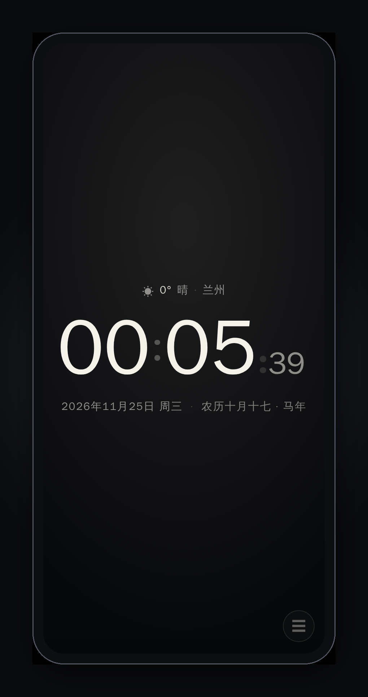
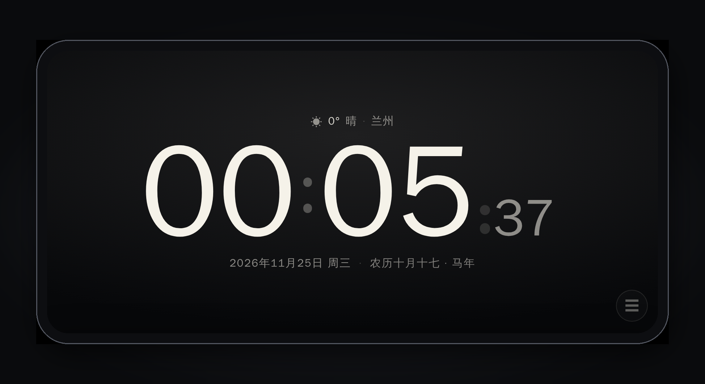

# 数字时钟 · Digital Clock

一个极简的安卓全屏数字时钟：**纯数字、无卡片**，附带农历、天气、整点报时，字体颜色与样式可调，支持横屏。




> 说明：应用用于把旧手机 / 平板变成桌面时钟、床头钟，或作工位副屏。界面上没有任何按钮和卡片，点右下角 `☰` 打开设置。

---

## 功能

| 模块 | 说明 |
| --- | --- |
| 主时间 | 大号 `HH:MM`，冒号用两个圆点绘制（不是字符），秒数小号显示，12/24 小时制可切换 |
| 日期 | 星期 + 年月日，随系统时间实时刷新 |
| 农历 | 由系统日历（`Intl.DateTimeFormat` 的 `zh-CN-u-ca-chinese`）计算，含中文日名、闰月、生肖、干支 |
| 天气 | 自动定位或手动选城市，显示当前温度 + 天气文字（晴 / 多云 / 小雨 …），失败自动重试，带本地缓存 |
| 整点报时 | 每到整点响铃，可开关、可试听 |
| 铃声 | 内置 4 种：叮咚（钟琴）、木鱼、教堂钟、电子嘀，全部离线 |
| 音量 | 10%–100% 滑杆 |
| 夜间静音 | 可设起止小时，支持跨零点（默认 23:00 – 07:00） |
| 横屏 | 自动 / 锁定横屏 / 锁定竖屏三档，横屏下自动放大时间、收窄行距 |
| 外观 | 背景色、数字色、字体（无衬线 / 等宽 / 衬线）、字重、字号、字距全部可调，设置存于 localStorage |

## 安装

- **直接装**：下载仓库根目录的 [`DigitalClock.apk`](DigitalClock.apk)，传到手机上安装（需允许「安装未知来源应用」）。
  要求 Android 7.0（API 24）及以上；已在 Android 9–14 上测试。
- **从源码装**：见下方「构建」。

覆盖安装说明：同签名（本仓库 `.signing/clock.jks`，未纳入版本库）可直接覆盖升级；换机器构建请沿用同一 keystore，或先卸载旧版。

## 构建

方式一，Android Studio：

```bash
git clone <this-repo> && cd DigitalClock
# 用 Android Studio 打开，直接 Run
```

方式二，不装 Gradle 的脚本构建（本项目的原始构建方式，产物 442 KB）：

```bash
export ANDROID_HOME=/path/to/android-sdk   # 需含 platforms/android-34 与 build-tools/33.0.1
./scripts/build.sh                         # 产物 build/DigitalClock.apk
```

签名用 `KEYSTORE`、`KEYSTORE_PASS`、`KEYSTORE_ALIAS` 环境变量指定自己的 keystore。

## 项目结构

```
app/src/main/
  AndroidManifest.xml
  java/com/doubao/digitalclock/MainActivity.java   # WebView 壳 + JS 桥（方向、HTTP 兜底）
  assets/
    index.html                                    # 全部界面与逻辑（单文件，零依赖）
    chime.wav wood.wav bell.wav beep.wav          # 内置铃声
  res/mipmap-*/ic_launcher.png
scripts/build.sh                                  # aapt2 + javac + d8 + apksigner 流水线
screenshots/                                      # 界面截图
DigitalClock.apk                                  # 预编译安装包（v1.3）
```

设计上刻意做成「一个 HTML 文件 + 一个极薄的 Java 壳」：界面、农历换算、天气拉取、报时逻辑都在 `index.html` 里，改样式不用重新编译 Java；壳只负责全屏、屏幕常亮、定位授权、屏幕方向，以及 WebView 里 fetch 失败时的 `AndroidHost.httpGet` 兜底。

`index.html` 本身可以直接用浏览器打开预览（`app/src/main/assets/index.html`），此时没有 wav 文件就自动改用 Web Audio 合成音。

## 数据来源与隐私

- 天气：主源 [Open-Meteo](https://open-meteo.com/)（无需 key），备源 [wttr.in](https://wttr.in)；城市反查用 BigDataCloud 的 reverse-geocode-client。
- 定位只用于取天气坐标，不存储不上传；也可手动搜索城市而完全不授权定位。
- 无统计 SDK、无广告、无账号，应用不联网时除天气外一切功能（含报时）正常。

## 已知限制

- 整点报时只在应用处于前台（亮屏、界面可见）时响；安卓限制后台网页播放，要做后台报时需要改为原生前台服务 + 通知权限。
- 天气依赖第三方公共接口，偶尔限流（主源 503 时自动切备源，最多 60 秒重试一次）。

## 更新日志

- **v1.3**：4 种铃声、音量滑杆、夜间静音时段。
- **v1.2**：整点报时 + 试听、屏幕方向锁定、横屏排版。
- **v1.1**：字体 / 字号 / 字重 / 字距 / 颜色可调，天气失败重试。
- **v1.0**：纯数字时钟、农历、天气。
- 更早的翻页时钟版本不在本仓库。

## License

[MIT](LICENSE)
